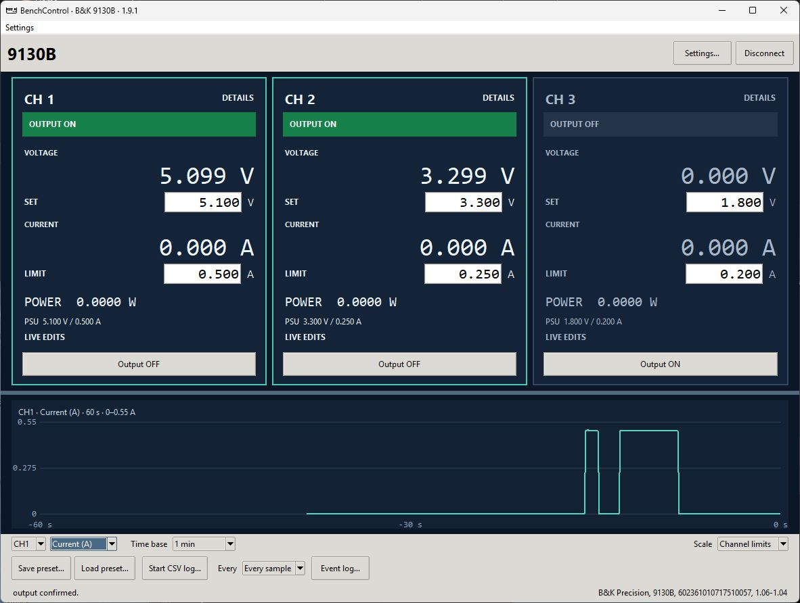
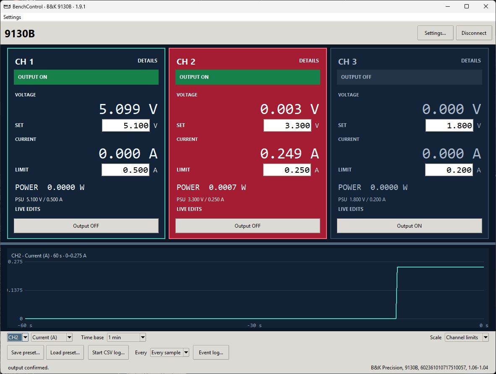
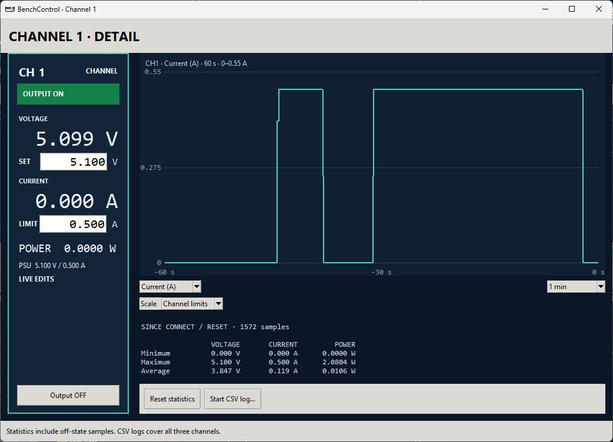
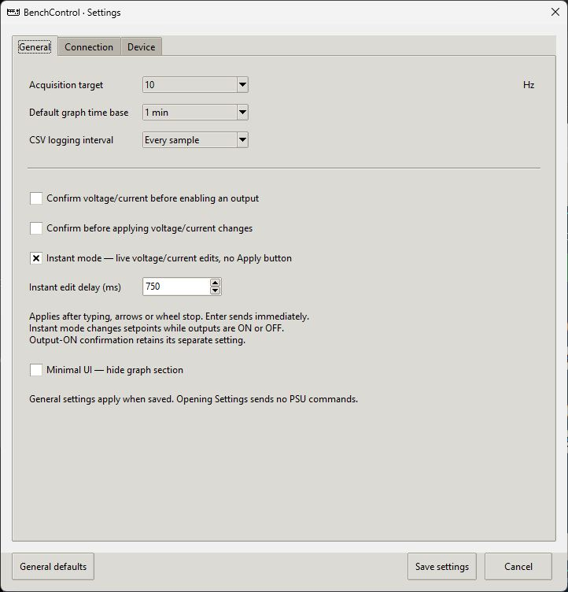

# BenchControl

Windows desktop control and monitoring for B&K Precision 9130B-series bench power supplies over USB. Set voltage and current limits, control each output, view live measurements and graphs, and record measurements to CSV.

[Download installer or portable version](releases/) · [Screenshots](images/) · [Source code](BenchControl-9130B/)

## Features

- Independent control of all three channels.
- Live voltage, current and calculated power readings.
- Manual setpoint control or optional Instant mode for live adjustments.
- Main and individual channel graphs with adjustable scales and time windows.
- Minimum, maximum and average readings.
- CSV logging and model-specific voltage/current presets.
- Saved preferences, a compact Minimal UI and Demo mode without hardware.

## Downloads

The [releases folder](releases/) contains the Windows installer and portable executable. Download the installer for an installed application, or the portable package to run without installing BenchControl.

NI-VISA is required for communication with the power supply.

## Supported models

| Model | CH1 and CH2, each | CH3 | Status |
| --- | --- | --- | --- |
| B&K Precision 9130B | 0–30 V / 0–3 A | 0–5 V / 0–3 A | Hardware operation reported in earlier versions |
| B&K Precision 9131B | 0–30 V / 0–6 A | 0–5 V / 0–3 A | Simulation tested; hardware unverified |
| B&K Precision 9132B | 0–60 V / 0–3 A | 0–5 V / 0–3 A | Simulation tested; hardware unverified |

BenchControl detects the connected model automatically. Independent channel operation is required. C-series and other 9xxx families are not currently enabled.

## Repository contents

| Folder | Contents |
| --- | --- |
| [BenchControl-9130B](BenchControl-9130B/) | Python source and application documentation |
| [images](images/) | Application screenshots |
| [releases](releases/) | Windows installer and portable executable |

The source version uses Python 3.11 or later, Tkinter and PyVISA. See the documentation in [BenchControl-9130B](BenchControl-9130B/) for setup and operating details.

## Screenshots

[View application screenshots](images/).

